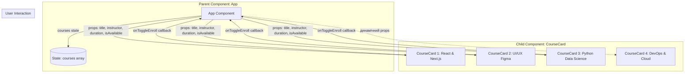

# Лабораторна робота: Конструктор карток навчальних курсів (React + Props)

Цей проєкт реалізовано в межах навчального завдання з дисципліни веб-розробки на React. Застосунок демонструє ключові концепції компонентного підходу, односпрямованого потоку даних (one-way data flow) та передачі параметрів через `props`.

---

## 📋 Зміст
1. [Вимоги та функціональність](#-вимоги-та-функціональність)
2. [Схема компонентів (Діаграма Props)](#-схема-компонентів)
3. [Структура даних Props](#-структура-даних-props)
4. [Індивідуальне завдання](#-індивідуальне-завдання)
5. [Аналіз власного рішення (Відповіді на запитання викладача)](#-аналіз-власного-рішення)
6. [Звіт про використання штучного інтелекту](#-звіт-про-використання-штучного-інтелекту)
7. [Інструкція із запуску](#-інструкція-із-запуску)

---

## 📌 Вимоги та функціональність

Застосунок відображає картки навчальних курсів із використанням єдиного перевикористовуваного компонента `CourseCard`.

Кожна картка містить обов'язкові атрибути відповідно до завдання:
* 🎓 **Назву курсу** (`title`)
* 👨‍🏫 **Ім'я викладача** (`instructor`)
* ⏱️ **Тривалість курсу** (`duration`)
* 🟢 **Інформацію про доступність запису** (`isAvailable`) — статус «Запис відкритий» або «Група набрана»

---

## 📐 Схема компонентів

### Діаграма ієрархії та передачі Props (Mermaid)



### Текстова схема структури:
```text
App (Батьківський компонент)
 ├── Header (Заголовок, опис, статистика)
 ├── ControlToolbar (Пошук, фільтр доступності, кнопки дій)
 ├── Main (Сітка карток)
 │    ├── CourseCard (props: курс 1, відкритий)
 │    ├── CourseCard (props: курс 2, закритий)
 │    ├── CourseCard (props: курс 3, відкритий)
 │    └── CourseCard (динамічний 4-й курс)
 └── DefensePanel (Вкладки зі схемою, відповідями та звітом ШІ)
```

---

## 📊 Структура даних Props

Компонент `CourseCard` приймає наступний набір властивостей:

| Назва Prop | Тип даних | Обов'язковий | Опис |
| :--- | :--- | :--- | :--- |
| `id` | `number` | Так | Унікальний ідентифікатор курсу |
| `title` | `string` | Так | Повна назва навчального курсу |
| `instructor` | `string` | Так | Ім'я та прізвище викладача |
| `duration` | `string` | Так | Тривалість навчання (тижні/години) |
| `isAvailable` | `boolean` | Так | Чи відкритий запис на курс |
| `category` | `string` | Ні | Напрямок навчання (Frontend, AI тощо) |
| `level` | `string` | Ні | Рівень підготовки студента |
| `rating` | `number` | Ні | Оцінка курсу (1.0 — 5.0) |
| `availableSeats` | `number` | Ні | Кількість вільних місць |
| `onToggleEnroll` | `function` | Ні | Колбек-функція для перемикання доступності |

---

## ✨ Індивідуальне завдання

У проєкті реалізовано інтерактивний функціонал:
1. **Динамічне перемикання доступності запису:** Кожна картка містить кнопку *«Змінити статус»*, яка викликає функцію `onToggleEnroll(id)` у батьківському компоненті `App`. Це наочно доводить, що зміна значення `props` миттєво змінює відображення на екрані (стиль бейджа, активність кнопки «Записатися», колір акценту).
2. **Фільтрація курсів:** Користувач може фільтрувати список: *«Всі курси»*, *«Тільки відкриті»* або *«Завершені»*.
3. **Живий пошук:** Пошук у реальному часі за назвою курсу, іменем викладача чи категорією.
4. **Кнопка «+ Додати 4-й курс»:** Демонстрація динамічного оновлення списку без дублювання коду.

---

## 💡 Аналіз власного рішення

### 1. Чому ви створили один компонент CourseCard, а не три окремі компоненти?
> **Відповідь:** Створення єдиного компонента `CourseCard` базується на принципі **DRY (Don't Repeat Yourself)** та концепції компоненто-орієнтованого програмування в React. 
> Всі три картки мають однакову розмітку (структуру), стилі CSS та логіку взаємодії. Створювати окремі компоненти означало б потрійне дублювання одного й того самого JSX-коду. Якщо в майбутньому знадобиться змінити вигляд картки (наприклад, додати бейдж або аватарку), достатньо відредагувати один файл `CourseCard.jsx`, а не вносити зміни у три окремі файли.

### 2. Як дані потрапляють із компонента App до CourseCard?
> **Відповідь:** Дані передаються зверху вниз за принципом **односпрямованого потоку даних (one-way data flow)** через механізм **props**:
> 1. У компоненті `App` зберігається масив об'єктів `courses` (за допомогою хука `useState`).
> 2. За допомогою функції вищого порядку `courses.map(...)` перебирається кожен елемент масиву.
> 3. Властивості об'єкта передаються як атрибути компонента: `<CourseCard title={course.title} instructor={course.instructor} ... />`.
> 4. У компоненті `CourseCard` ці параметри приймаються як перший аргумент функції у вигляді деструктуризованого об'єкта `{ title, instructor, duration, isAvailable }` і підставляються у відповідні місця JSX-розмітки.

### 3. Що потрібно змінити, щоб додати четвертий навчальний курс?
> **Відповідь:** Завдяки динамічному рендерингу списку через `map()`, **структуру коду і компоненти змінювати взагалі не потрібно**. 
> Достатньо лише додати новий об'єкт із даними 4-го курсу до масиву `courses` (або натиснути кнопку *«+ Додати 4-й курс»* у додатку). React автоматично створить новий екземпляр `CourseCard` та передасть йому відповідні `props`.

---

## 🤖 Звіт про використання штучного інтелекту

Відповідно до вимог навчальної програми:

* **Як саме використовувався ШІ:**  
  ШІ (Google Gemini) використовувався як інтерактивний асистент парного програмування:
  - Допомога у швидкому розгортанні структури проєкту на базі Vite + React;
  - Створення структури props відповідно до вимог завдання;
  - Розробка сучасного стильного UI на ванільному CSS без важких сторонніх бібліотек;
  - Формулювання лаконічних та точних теоретичних відповідей для захисту роботи.

* **Які рекомендації ШІ було прийнято:**
  - Деструктуризація `props` безпосередньо у сигнатурі функції компонента `CourseCard` для підвищення читабельності коду;
  - Додавання зворотного колбеку `onToggleEnroll` для практичної перевірки зміни значення props;
  - Вбудована панель самоперевірки та візуалізації схеми компонентів прямо в інтерфейсі.

* **Які рекомендації ШІ було відхилено і чому:**
  - Пропозицію використати TailwindCSS або зовнішні UI-бібліотеки було відхилено, оскільки навчальна мета полягає у розумінні чистого React та власного CSS;
  - Створення статичних карток без передачі через масив та метод `map()` було відхилено на користь професійного React-підходу.

---

## 🚀 Інструкція із запуску

1. **Клонуйте репозиторій:**
   ```bash
   git clone <URL_ВАШОГО_РЕПОЗИТОРІЮ>
   cd course_card_lbReact
   ```

2. **Встановіть залежності:**
   ```bash
   npm install
   ```

3. **Запустіть локальний сервер розробки:**
   ```bash
   npm run dev
   ```

4. Відкрийте посилання у браузері (за замовчуванням: `http://localhost:5173/`).
